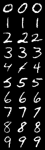

###  **Stochastic Interpolant Based Flow & Diffusion**


This project implements stochastic interpolants based diffusion and flow models. 
A lot of it is inspired by the following papers

- [An introduction to Flow and Diffusion Models](https://arxiv.org/abs/2506.02070)
- [Stochastic Interpolants, a unifying framework for flow and diffusion models](https://arxiv.org/abs/2303.08797)

***
 
The model is trained using flow matching, which directly learns the vector field $u_t^{\theta}(x)$, not the noise or score function. 

To sample from the flow model, an ODE solver is used on the vector field(Euler)

To sample from the diffusion model, an SDE solver is used. 

Classifier-free guidance is also implemented 
***

### Setup
```bash 
git clone git@github.com:Blaise143/stochastic-interpolant-diffusion.git
cd stochastic-interpolant-diffusion
pip install -e .
```

### Usage
Config is managed with [Hydra](https://hydra.cc) (`config/config.yaml`), so instead of `--flag value` you override
any field with `key=value`, and Hydra prints `--help` for the full list. Every run's resolved config, logs, and
outputs land in their own `outputs/<date>/<time>/` folder.

#### Training

Train the flow model with the defaults (linear scheduler, Euler solver, no experiment logger):
```bash
python main.py
```

Override training hyperparameters, switch to classifier-free guidance, or swap out a config group
(`scheduler`: linear/polynomial/trigonometric, `solver`: euler/midpoint, `logger`: none/tensorboard/wandb):
```bash
python main.py epochs=100 batch_size=200 lr=1e-3
python main.py guided=true guidance_scale=2.0
python main.py scheduler=polynomial logger=wandb
```

For multi-GPU training, launch with `torchrun` instead of `python` (DDP is wired up automatically):
```bash
torchrun --nproc_per_node=4 main.py epochs=100
```

#### Sampling

Flow model, Euler ODE solver:
```bash
python main.py mode=sample model_type=flow num_samples=10 num_steps=500 guided=true guidance_scale=2.0 save_path=images/flow_samples.png
```

Restrict to specific digits, or use the midpoint solver instead:
```bash
python main.py mode=sample model_type=flow digits="0,1,2" num_samples=5 guided=true guidance_scale=2.0
python main.py mode=sample model_type=flow solver=midpoint
```

Diffusion model, Euler-Maruyama SDE solver:
```bash
python main.py mode=sample model_type=diffusion num_samples=10 num_steps=500 guided=true guidance_scale=2.0 save_path=images/diffusion_samples.png
python main.py mode=sample model_type=diffusion num_samples=10 num_steps=500  # unguided
```

<!-- <p align="center"></p> -->

***

Alright, see ya later mate 

